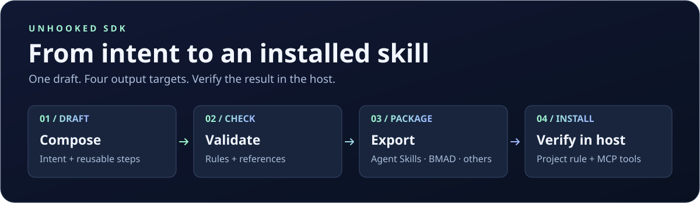
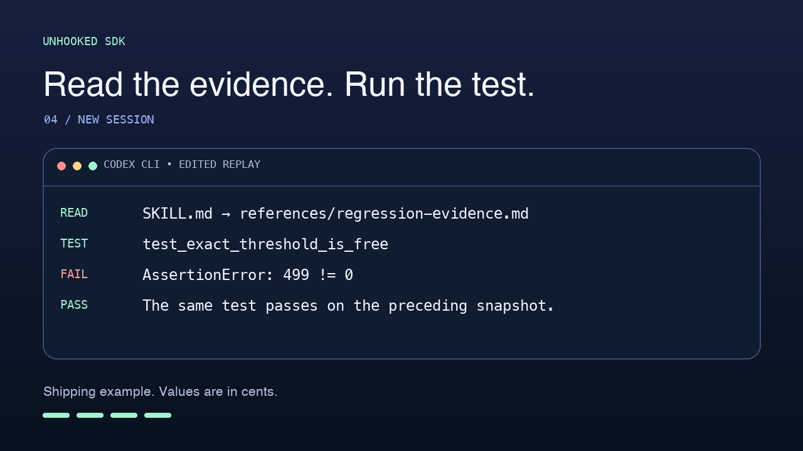

# Unhooked SDK

**Build skills for coding agents by talking to Codex.** Describe the skill you want. Codex turns that request into a draft, checks it, and prepares a package for Agent Skills, BMAD, OpenSpec, or Spec Kit.

## Start with a prompt

Open a Codex session in a project you control. If your team has given you access to an SDK release, paste:

> Set up Unhooked SDK and its BMAD regression workflow in this project. Use the SDK checkout or release I have access to. Follow its installation guide, keep my existing project settings, and verify that the workflow and tools are available in a new Codex session. Ask for approval if a project installation write needs it.

Give Codex the approved source location if it cannot find one. The setup and the examples below are all driven through the chat. This public repository contains the guides and demo; SDK source access is separate.

- [Install in Codex](docs/Install-in-Codex.md)
- [How it works](docs/How-it-works.md)
- [Prompts to try](docs/Examples.md)
- [Clean Codex demo](docs/Demo.md)

