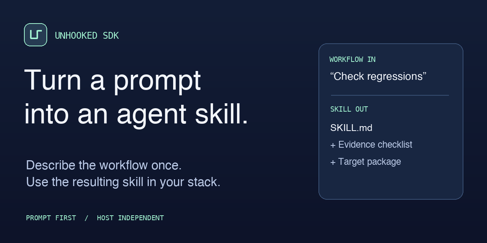

# Unhooked SDK

**Turn a workflow prompt into an installable skill for AI agents.**

If you keep telling a coding agent how to reproduce a regression or review a change, turn that instruction into a skill. A skill tells the agent **when to act, what steps to follow, and what evidence to return**. Unhooked checks the draft and packages it for the agent framework you choose.

[Quickstart](docs/Install-in-Codex.md) · [Example skill](examples/regression-check/SKILL.md) · [Watch the demo](docs/Demo.md) · [Wiki](https://github.com/mikegorelikoff/unhooked-sdk/wiki)

## What goes in and what comes out

> Create a skill that investigates functional regressions. Have it write or run one focused test, compare expected and actual behavior, and report the evidence. Prepare an Agent Skills package.

**The output:** a skill draft, a validation report, and a package containing the instructions and their reference files. Browse the [sample skill](examples/regression-check/SKILL.md) and the [evidence checklist](examples/regression-check/references/evidence.md) to see what an output can look like.

Unhooked prepares packages for **Agent Skills, BMAD, OpenSpec, and Spec Kit**. Package preparation and live execution are separate. After installation, the agent host decides how it finds and runs the skill.

## Work from your agent chat

1. **Describe** the workflow and the evidence you want back.
2. **Check** the draft and fix missing or unsupported behavior.
3. **Package** it for the framework you use.
4. **Install and verify** it in a project you control.

The SDK exposes the authoring tools through MCP (Model Context Protocol) for compatible agent hosts. The [recorded Codex demo](docs/Demo.md) shows one verified BMAD setup and a separate regression run. See [How it works](docs/How-it-works.md) for the output formats and what was verified.

## Availability

This public repository contains guides, examples, and demo media under [CC BY 4.0](LICENSE). The SDK implementation and releases require separate access. If you already have access, follow the [prompt-only quickstart](docs/Install-in-Codex.md). Report documentation gaps through [GitHub Issues](https://github.com/mikegorelikoff/unhooked-sdk/issues/new/choose).
