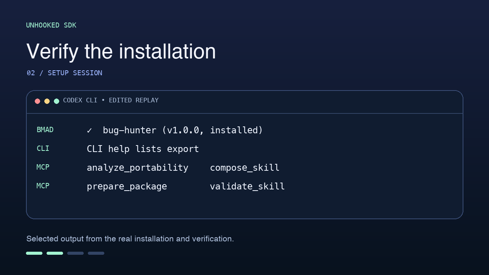
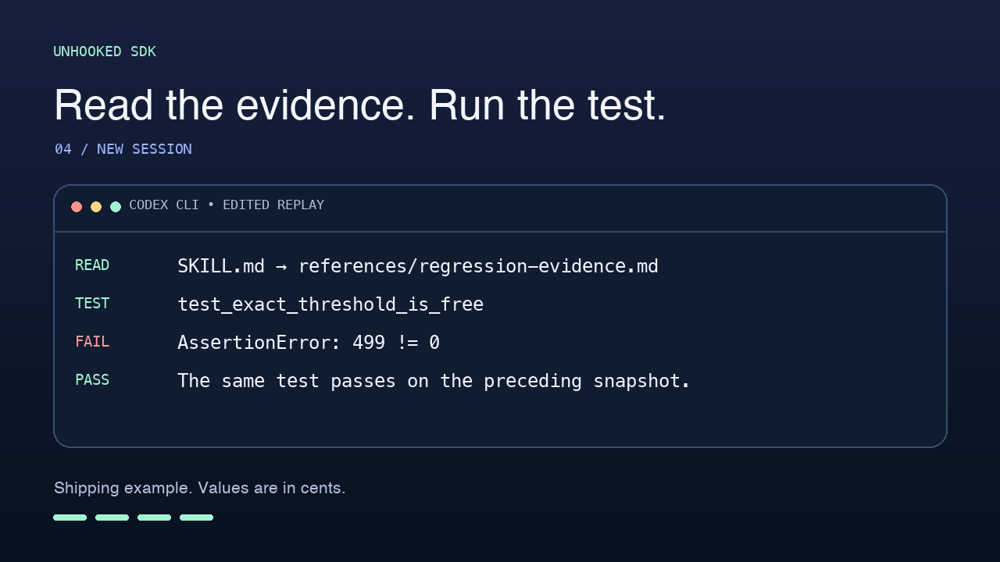

# Clean Codex demo

The demo follows two actual fresh Codex CLI sessions: a project setup and a regression investigation in a small shipping example. It shows selected terminal output. The setup was recorded against a release accessible at the time; access to the SDK is now separate from this public guide.

1. Paste the [setup prompt](Install-in-Codex.md). Codex installs and checks the project tools.
2. In a fresh session, describe the shipping regression [without naming a skill](Examples.md#reproduce-a-regression).
3. See the agent open the regression workflow, run a focused test, and report the assertion.

[Watch the 22-second replay](https://raw.githubusercontent.com/mikegorelikoff/unhooked-sdk/main/docs/assets/codex-demo.mp4)

