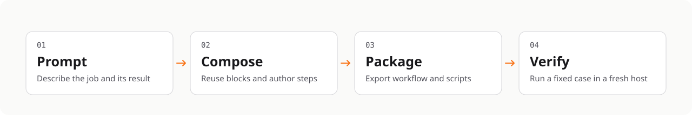

# How it works

The agent authors the skill from the prompt. The SDK composes and checks the draft, then writes the files for the selected target. The agent host reads the package and runs the steps.

| Stage | What you get |
| --- | --- |
| Describe | Activation conditions, step inputs and outputs, and what counts as done. |
| Compose and validate | Components assembled in dependency order and diagnostics for structural problems. |
| Package | Target-specific files and SHA-256 digests for their exact bytes. |
| Verify | Evidence from the configured test case in a fresh host session. |

## Export profiles

| Target | Package |
| --- | --- |
| Agent Skills | A standard directory with `SKILL.md`, numbered step files and any declared scripts or resources. |
| BMAD | A custom module with a help entry. Installed skill files carry the same step layout. |
| OpenSpec | A companion skill used with an explicit change ID. |
| Spec Kit | An extension with an explicitly invoked command. Script-free steps are inlined. The profile rejects authored workflow scripts. |

The [checkout example](../examples/checkout-threshold-audit/SKILL.md) includes the HX step mapping. The [verification guide](Verification.md) explains which parts of a run are independently observed.
