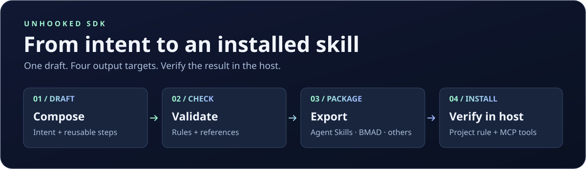

# How it works

Your prompt describes a skill: when it applies, what the agent should do, and what evidence it should return. Codex turns the request into a draft, resolves reusable instructions, validates the draft, and prepares a package for your chosen target.

| You ask Codex to… | Codex gives you… |
| --- | --- |
| Draft a skill | A description, use cases, instructions and evidence requirements. |
| Check the draft | Diagnostics for missing or invalid inputs and a report on what the chosen target supports. |
| Package the skill | Files for Agent Skills, BMAD, OpenSpec, or Spec Kit. |
| Install and verify it | Evidence that your project can discover and use the installed skill. |

The package and the live check are separate. In the BMAD example, a project rule tells fresh Codex sessions to open the installed workflow on reports of an ordinary functional regression.

[Set up the SDK](Install-in-Codex.md) · [Try prompts](Examples.md)
